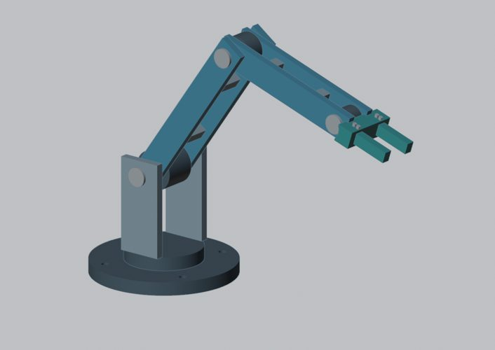
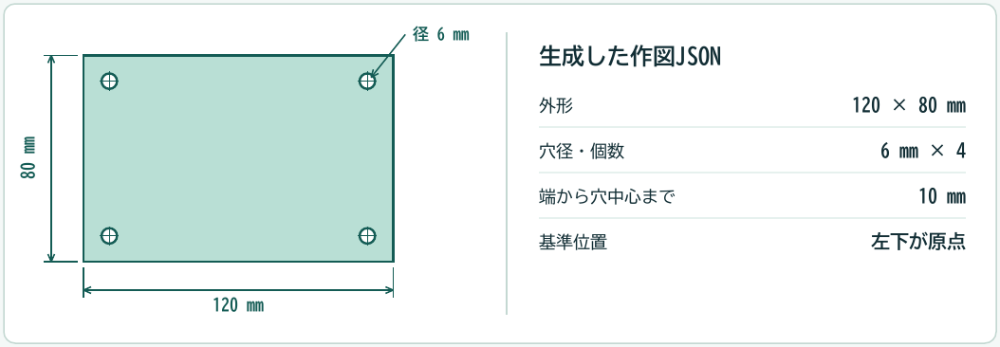

# ことばCAD

自然言語で指定した形状や寸法から、AutoCADの図面を自動生成してDWGに出力する個人開発です。日本語の指示を**作図JSONに変換し、Pythonで検証してからAutoCADで作図**します。

[提出用ポートフォリオ（PDF）](KotobaCAD_Portfolio.pdf) · [公開デモ](https://kotoba-cad-demo.atom01090109.chatgpt.site/)

## 作図例　「ロボットアームを作って」から新規生成

> ロボットアームを作って

出発点はこの一文だけです。既存のCADモデルや寸法図がない状態から、対話で用途と必要な条件を詰め、構成を決めてロボットアームのCADモデルを生成しました。

同梱の搬送デモでは、把持位置・配置位置・荷物の寸法と質量のうち、不足している項目を対話で確認できます。確定した条件をもとに、部品カタログからアームの構成を選び、搬送経路の干渉と関節の負荷を確認して、把持時・配置時の作図データを生成します。

## 作図例　四つ穴プレート

> 原点を左下に、120 mm × 80 mmのプレート。四隅に直径6 mmの通し穴。各辺から穴中心までの距離は10 mm。

[この指示から生成した作図JSON](plate.json)には、左下を原点とする四つ穴プレートのテンプレートと、外形寸法、穴径、穴中心の端からの距離が入ります。図はそのJSONの寸法を使って描画しました。

## 入力からDWG出力まで

1. **入力を構造化**　日本語の指示から形状と寸法を取り出し、作図JSONに変換します。
2. **Pythonで検証**　寸法や、作図命令が参照する図形を検証します。
3. **AutoCADで作図**　検証したデータからAutoCAD ActiveXで形状を生成し、DWGに保存します。

四つ穴プレートの例では、日本語からのJSON生成と検証を実行しました。DWG出力にはWindows版AutoCADを使います。

## 追加機能　生成したモデルを対話で修正

生成済みのモデルに対して、外部LLM（Groq）との対話で寸法の変更案を作り、利用者が確認・承認して反映できます。下図は模擬応答を使い、中央の箱の幅を70 mmから60 mm、高さを24 mmから18 mmに変更した再現例です。

